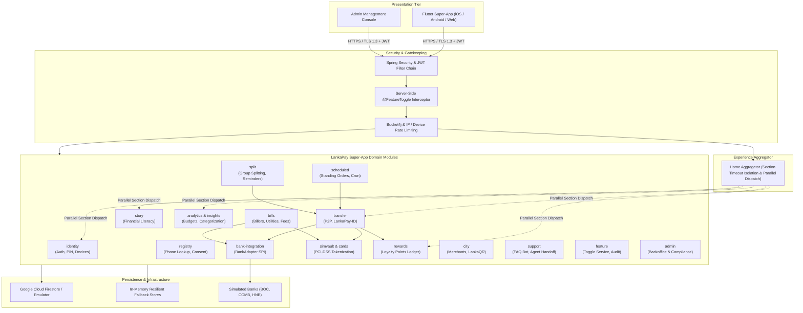
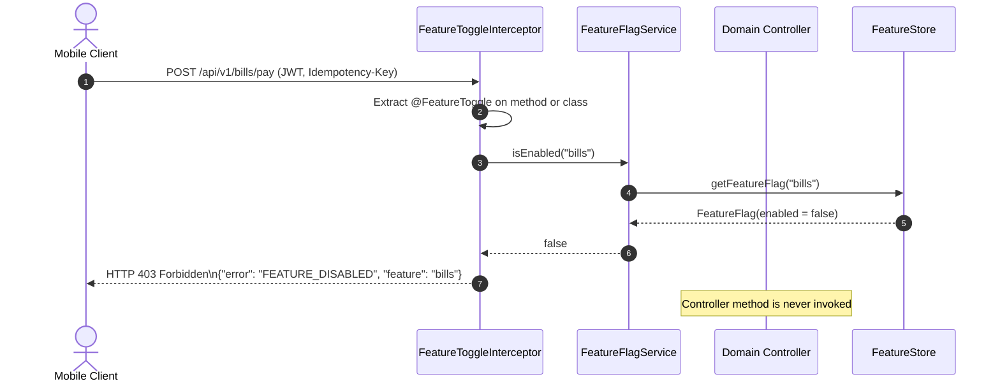

# LankaPay Super-App – Architecture Specification

> **Status**: Production Reference & System Design  
> **Target Platform**: Spring Boot 3 (Java 21) Modular Monolith + Flutter Cross-Platform Mobile Client  
> **Simulation Disclaimer**: This system operates against simulated banking systems (SimVault, Bank Adapters). Test funds only.

---

## 1. Architectural Style & Design Principles

LankaPay Super-App employs a **modular monolith** architecture deployed as a cohesive Spring Boot application. High cohesion within domain boundaries and compile-time decoupling between modules prevent spaghetti dependencies while avoiding distributed systems failure modes during prototyping.



### Core Architecture Principles:
1. **Integer Minor Units Invariant (`amountMinor`)**: All monetary values are represented as 64-bit signed integers in minor currency units (1 LKR = 100 cents/minor units). Floats/doubles are strictly forbidden for balance, transfer, and bill calculations.
2. **Point Separation Invariant**: Loyalty points are tracked in a dedicated non-fiat ledger. Points are whole numbers, earned exclusively upon confirmed transaction `COMPLETED` state, reversed automatically upon refund, and never co-mingled with fiat bank balances.
3. **Server-Side Feature Flag Enforcement**: Feature availability is guarded on the backend using the `@FeatureToggle` annotation and `FeatureToggleInterceptor`. Disabled features return HTTP 403 `FEATURE_DISABLED` with a structured payload regardless of client state.
4. **Resilient Failure Isolation (Home Aggregator)**: Aggregation executes sub-queries in parallel threads with a 400ms hard ceiling. If an individual module (e.g., Stories, Analytics) experiences high latency or failure, the aggregator responds in < 500ms with healthy sections and status `FAILED` or `UNAVAILABLE` for degraded sections.
5. **Idempotency Guarantee**: All fund movement endpoints (`/transfers`, `/bills/pay`, `/scheduled/create`) mandate an `Idempotency-Key` HTTP header. Replaying the same key returns the existing transaction without duplicate ledger mutation.

---

## 2. Domain Modules & Responsibilities

| Module | Package | Primary Responsibilities |
|---|---|---|
| **identity** | `com.lankapay.identity` | Registration, credential validation, 6-digit security PIN (BCrypt), JWT issuance, OTP rate-limiting, account locking. |
| **registry** | `com.lankapay.registry` | Phone-to-account directory (LankaPay-ID), discoverability flags, privacy opt-out. |
| **bank-integration** | `com.lankapay.bank` | `BankAdapter` SPI, simulated bank adapters (`BANK_A`, `BANK_B`, `BANK_C`), account linking, mock balances. |
| **simvault & cards** | `com.lankapay.cards`, `com.lankapay.simvault` | PCI-DSS tokenization vault, tokenized debit/credit cards, card locking, daily/transaction velocity limits. |
| **transfer** | `com.lankapay.transfer` | Fund transfer execution, two-phase commit simulation, transaction status state machine, anti-self-dealing verification. |
| **bills** | `com.lankapay.bills` | Utility and telecom bill payments, simulated convenience fee calculation, receipt generation. |
| **scheduled** | `com.lankapay.scheduled` | Recurring standing orders, automated cron dispatcher, pause/resume, execution history ledger. |
| **split** | `com.lankapay.split` | Multi-party bill splitting (equal and custom), participation status, rate-limited payment reminders. |
| **rewards** | `com.lankapay.rewards` | Loyalty points ledger, points accrual on completed transfers, reversal deduction, partner voucher redemption. |
| **city** | `com.lankapay.city` | Merchant directory, category search (food, fuel, grocery), LankaQR payload resolution, merchant discount offers. |
| **support** | `com.lankapay.support` | Customer service chat, simulated automated FAQ bot, human agent handoff, canned resolution replies. |
| **story** | `com.lankapay.story` | Educational financial literacy stories, read/seen tracking, whitelist deep-link routing. |
| **analytics & insights**| `com.lankapay.analytics`, `com.lankapay.insight` | Monthly spending breakdown, automated categorization, monthly budget limits, smart financial nudges. |
| **feature** | `com.lankapay.feature` | Server-side feature toggle engine, HTTP 403 enforcement, audit logging of toggle modifications. |
| **admin** | `com.lankapay.admin` | Administrative supervisor console, account freeze/unfreeze, transaction inspection, audit logs. |

---

## 3. Server-Side Feature Toggle Enforcement

Client-side hiding of UI elements is insufficient for enterprise financial security. The LankaPay backend enforces toggle states via `@FeatureToggle(FeatureName.X)` annotations:



---

## 4. Home Aggregator SLA & Concurrency Architecture

The Home Screen displays a unified neo-banking dashboard composed from 6 separate systems. To meet the < 500ms p95 SLA requirement, the aggregator uses parallel non-blocking execution:

```mermaid
sequenceDiagram
    autonumber
    actor Client as Mobile App
    participant Aggregator as HomeAggregatorService
    participant Greeting as Identity Thread
    participant Wallet as Bank/Vault Thread
    participant Spend as Analytics Thread
    participant Rewards as Rewards Thread
    participant Stories as Story Thread
    participant Nudge as Insight Thread

    Client->>Aggregator: GET /api/v1/home
    Note over Aggregator: Start timer; dispatch CompletableFutures
    par Parallel Section Fetch
        Aggregator->>Greeting: getGreeting(userId)
        Aggregator->>Wallet: getWalletSummary(userId)
        Aggregator->>Spend: getSpendSummary(userId)
        Aggregator->>Rewards: getRewardsSummary(userId)
        Aggregator->>Stories: getActiveStories(userId)
        Aggregator->>Nudge: getActiveNudge(userId)
    end
    Note over Aggregator: CompletableFuture.allOf().orTimeout(400, MILLISECONDS)
    Greeting-->>Aggregator: GreetingData (OK)
    Wallet-->>Aggregator: WalletData (OK)
    Spend-->>Aggregator: SpendData (OK)
    Rewards-->>Aggregator: RewardsData (OK)
    Stories-->>Aggregator: StoriesData (OK)
    Nudge-->>Aggregator: NudgeData (OK)
    Aggregator-->>Client: HTTP 200 HomeAggregateResponse (Elapsed: ~120ms)
```

### Timeout & Failure Isolation:
- **Hard Timeout**: 400ms per section. If a downstream service exceeds this ceiling, the specific section returns `status = "TIMEOUT"` or `status = "UNAVAILABLE"` with error metadata, while healthy sections return valid data with `status = "OK"`.
- **Global SLA**: Aggregator execution completes in < 500ms even under concurrent 20-thread load.

---

## 5. Security Architecture

1. **Authentication**: Stateless HMAC-SHA256 JWT tokens. Token lifespan 60 minutes with separate refresh tokens.
2. **Step-Up Authentication**: High-value transactions (bill pay, scheduled payments, unfreezing cards) require `X-Step-Up-Pin` header verified against the user's BCrypt PIN hash.
3. **Data Masking**:
   - Card PANs: `**** **** **** 1234`
   - Bank Account Numbers: `•••• 5678`
   - NIC / Phone: Masked in support chat and audit representations.
4. **Anti-Self-Dealing**: The transfer engine strictly validates that `senderUserId != receiverUserId` and `fromAccountId != toAccountId`.
5. **Output Sanitization**: Story titles, captions, and chat message contents are HTML/XSS-sanitized to prevent payload injection into mobile webviews or rich text renderers.
