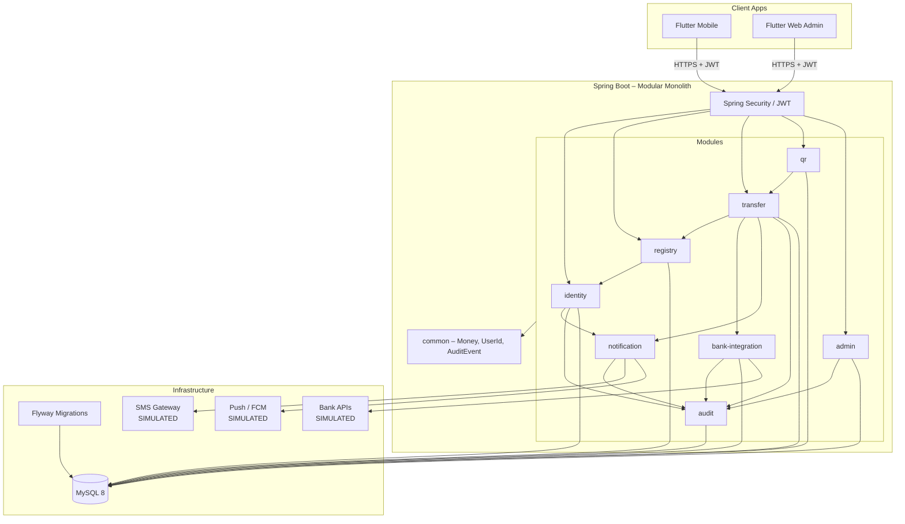

# Lanka Pay – Architecture

> **Draft** – will be updated once `docs/MASTER_PROMPT.md` is populated.

---

## 1. Architectural Style

Lanka Pay uses a **modular monolith** deployed as a single Spring Boot application. Modules are separated by Java package boundaries, not by network. This keeps deployment simple (one JAR, one database) while enforcing clear ownership and preventing cross-module coupling via compile-time rules.

Key constraints:
- Modules communicate through **public service interfaces** only. Direct repository access across modules is forbidden.
- All bank / payment-network interaction goes through the **`BankAdapter`** interface in the `bank-integration` module. No other module may call a bank API directly.
- The database schema is logically partitioned per module (table-name prefixes). A single Flyway migration history manages all DDL.

---

## 2. Module List

| Module | Package | Responsibility |
|---|---|---|
| **identity** | `com.lankapay.identity` | User registration, login, JWT issuance, password/OTP management |
| **registry** | `com.lankapay.registry` | Phone-number → account mapping (discovery service), privacy controls |
| **bank-integration** | `com.lankapay.bank` | `BankAdapter` interface + SIMULATED implementations, bank account linking, balance enquiry |
| **transfer** | `com.lankapay.transfer` | Initiate, confirm, and record peer-to-peer and bank transfers |
| **qr** | `com.lankapay.qr` | QR code generation, parsing, and QR-triggered payment flow |
| **notification** | `com.lankapay.notification` | SMS and in-app push notifications (OTP delivery, payment alerts) |
| **audit** | `com.lankapay.audit` | Immutable audit log of all sensitive events (login, transfers, admin actions) |
| **admin** | `com.lankapay.admin` | Admin-only APIs: user management, transaction lookup, system health |

---

## 3. Module Dependencies

```
identity  ──► notification   (send OTP SMS)
identity  ──► audit          (log auth events)

registry  ──► identity       (resolve user from phone)

bank-integration  ──► notification  (alert on link/unlink)
bank-integration  ──► audit         (log adapter calls)

transfer  ──► identity       (resolve sender/receiver)
transfer  ──► registry       (lookup payee by phone)
transfer  ──► bank-integration (debit/credit via BankAdapter)
transfer  ──► notification   (payment confirmation SMS/push)
transfer  ──► audit          (log every transfer attempt)

qr        ──► transfer       (hand off to transfer after QR parse)
qr        ──► identity       (resolve QR owner)

admin     ──► identity       (user admin)
admin     ──► transfer       (transaction lookup/refund)
admin     ──► audit          (read audit log)
admin     ──► bank-integration (adapter health)

notification  ──► audit      (log notification delivery)
```

Rules:
- `audit` has **no outbound dependencies** (nothing imports from it except to write events).
- `notification` has **no outbound dependencies** beyond infrastructure (SMS gateway, FCM).
- Circular dependencies are **not permitted**.

---

## 4. Shared Kernel

A small `com.lankapay.common` package holds types used by all modules:

- `Money` – value object wrapping `BigDecimal amount` + `String currency` (always `"LKR"`).
- `UserId`, `AccountId` – typed ID wrappers to prevent accidental swaps.
- `AuditEvent` – base record written to the audit module.
- Exception hierarchy (`LankaPayException`, `ValidationException`, `AuthorizationException`).
- `SimulatedResponseUtil` – utility that stamps `"simulated": true` on every bank adapter response.

---

## 5. Security Layers

```
Client (Flutter)
    │  HTTPS / TLS 1.3
    ▼
Spring Security filter chain
    │  JWT validation (every request)
    ▼
Controller layer (@PreAuthorize / object-level checks)
    │
    ▼
Service layer (business logic + BankAdapter calls)
    │
    ▼
Repository layer (Spring Data JPA)
    │
    ▼
MySQL 8 (single schema, Flyway-managed)
```

---

## 6. Component Diagram



---

## 7. Key Design Decisions

| Decision | Rationale |
|---|---|
| Modular monolith over microservices | Single deployment unit; simpler for a university prototype with a small team |
| `BankAdapter` interface | Decouples business logic from simulated/real bank implementations; swap without changing transfer logic |
| Flyway for migrations | Reproducible schema across all environments; version history in source control |
| JWT stateless auth | No server-side session store needed; works across mobile and web clients |
| BigDecimal for money | Avoids floating-point rounding errors on financial amounts |
| Table-prefix per module | Single DB, logical separation; avoids cross-module JOINs in the ORM |
