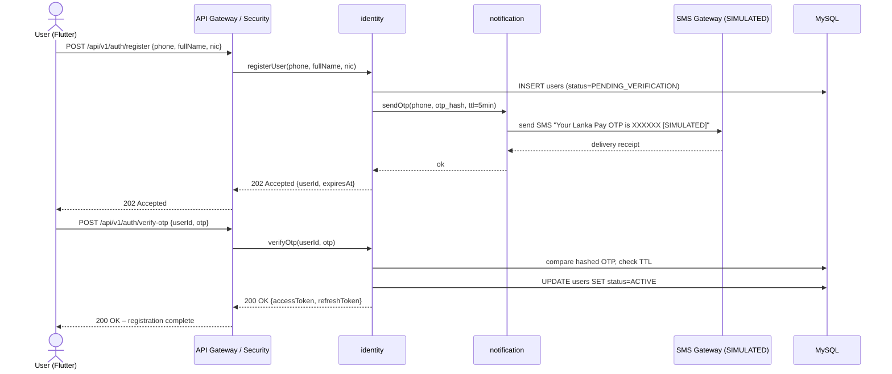
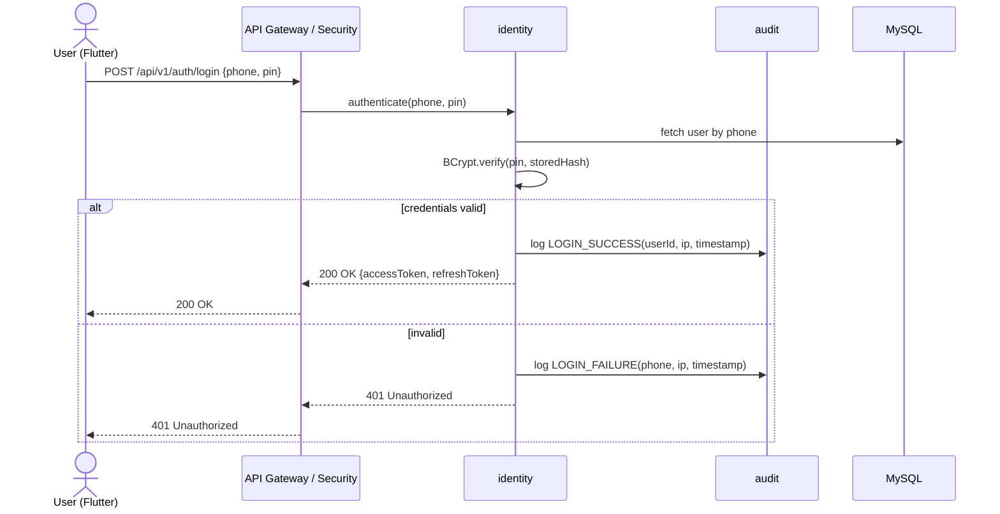
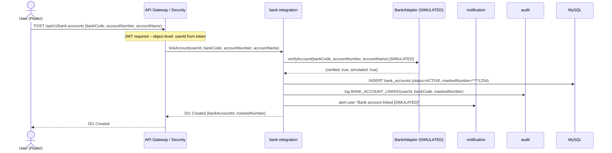
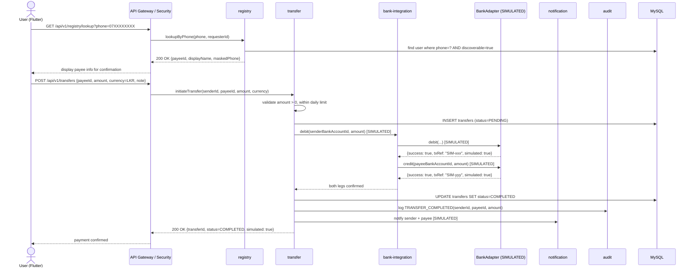
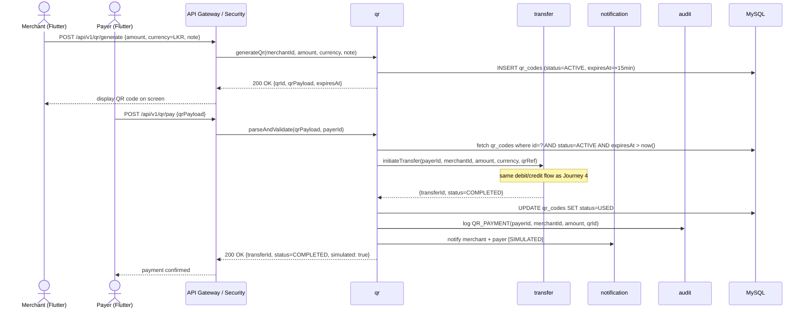
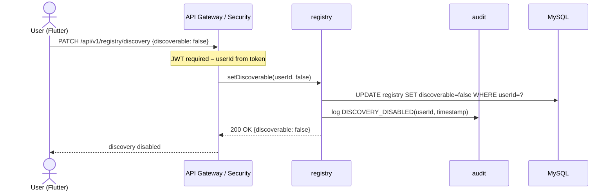
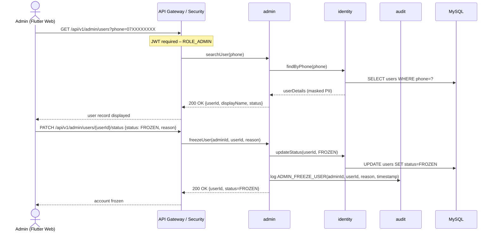

# Lanka Pay – User Journeys

> **Draft** – will be refined once `docs/MASTER_PROMPT.md` is populated.

All sequence diagrams use the module names from `architecture.md`.
"SIMULATED" labels appear wherever a bank or SMS interaction occurs.

---

## 1. Register & Verify Phone

A new user installs the app, enters their phone number, verifies via OTP, and sets a PIN/password.

---

## 2. Login

Existing user logs in with phone + PIN, receives JWT.

---

## 3. Link a Bank Account

User adds a bank account; the adapter verifies it with the (simulated) bank.

---

## 4. Lookup Payee + Initiate Transfer

User enters a phone number, looks up the payee, reviews, and confirms a transfer.

---

## 5. QR Code Payment

Merchant displays a QR; payer scans it and confirms payment.

---

## 6. Disable Discovery (Privacy Control)

User opts out of phone-number lookup by other users.

---

## 7. Admin: View & Freeze Account

Admin looks up a user and freezes their account.

